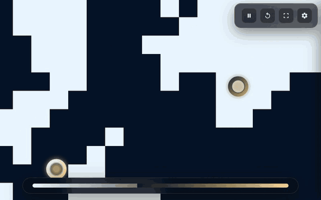
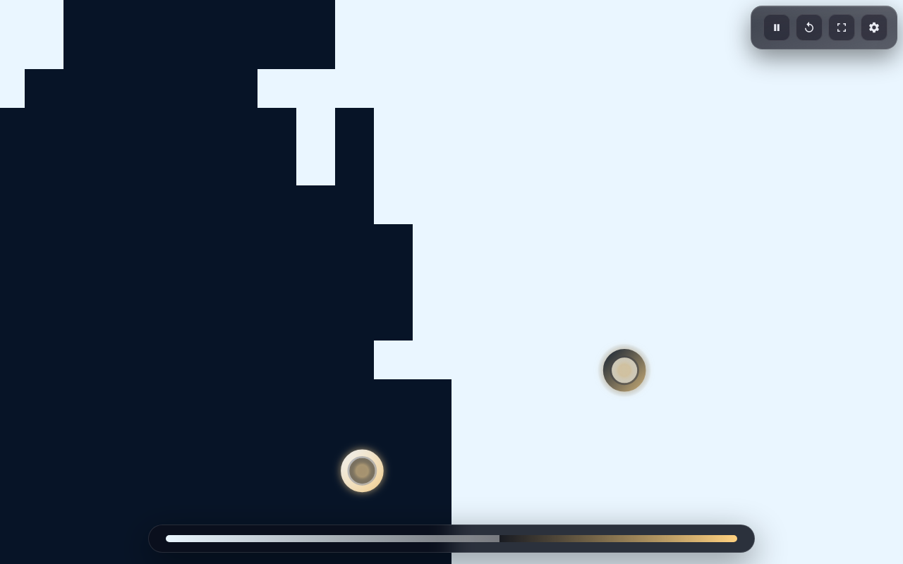
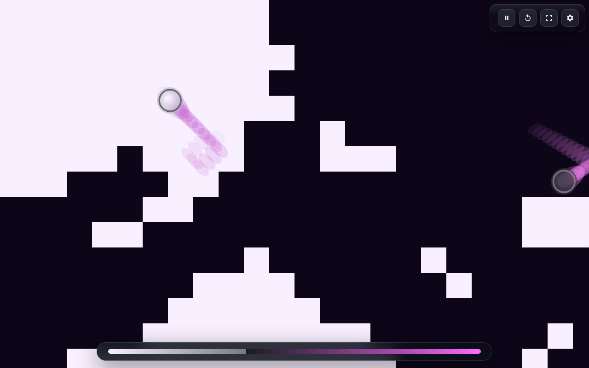
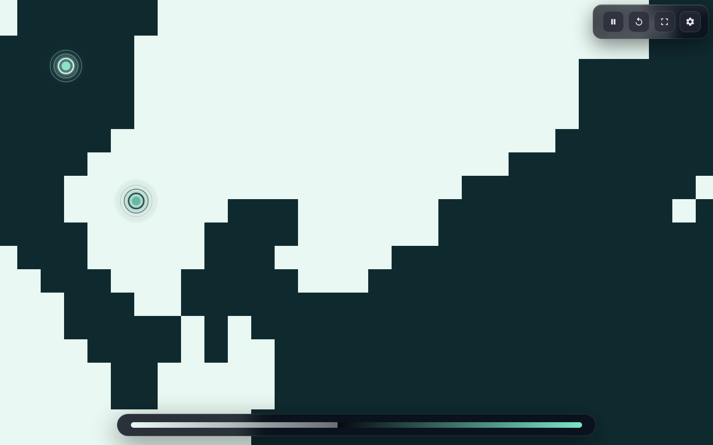
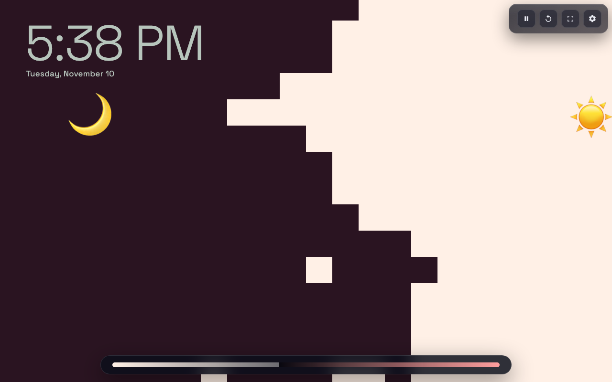

# endless pong

**play it here:** https://pong-screensaver.vercel.app



two balls, one grid, forever. each ball paints every tile it touches its own color and bounces off the other side's territory, so the border between light and dark just keeps sloshing around. it never ends and it's weirdly hard to look away from.

this is a fork of marko denic's **dynamic pong wars**:
https://github.com/markodenic/dynamic-pong-wars
which itself is based on koen van gilst's original **pong wars**:
https://github.com/vnglst/pong-wars

his is great but i just decided to make it look prettier so it can be a screensaver

---

## what's different vs dynamic-pong-wars
- **way more knobs**: speed mood dial, chaos slider, tile size/density slider, scatter start, swap sides, reset settings (without nuking the current board)
- **cinematic mode (experimental)**: when a side is getting crushed (~70/30), the losing ball gets a tiny assist so comebacks can happen
- **palette gallery** with a bunch of curated themes + custom day/night pickers that autosave
- **ball style gallery** (glow, halo, soft core, grid lines, ghost trail, comet tail, sparkburst, etc)
- **drawer ui** so the sim stays clean; optional auto-hide chrome + hide score bar
- **an actual screensaver mode** (see below)
- **installable + works offline**, so it can live in your dock or on your home screen
- **share a look as a link**: every setting lives in the url
- **its bigger** fullscreen baby
- lil custom favicon

none of the collision / takeover rules are changed on purpose — that part is already perfect. there's a test that runs the original code and the current code side by side with the same random seed and fails if a single tile or a single float comes out different.

<table>
  <tr>
    <td></td>
    <td></td>
  </tr>
  <tr>
    <td></td>
    <td></td>
  </tr>
</table>

---

## using it as a screensaver

hit **F** (or the corners button top-right). it goes fullscreen, hides every bit of ui and the cursor, and keeps your screen awake. wiggle the mouse to get the buttons back, **esc** to leave.

stuff it does while it's in there:
- **keeps the display on** with the screen wake lock api (also when it's fullscreen or installed as an app). paused or hidden tab = lock released
- **burn-in protection**: the whole board slowly drifts a few pixels around, one device pixel at a time so nothing gets blurry. turn on **shuffle looks** too and it crossfades to a new palette + ball style every 3 minutes
- **backgrounded tab = paused**. it doesn't secretly fast-forward to catch up when you come back
- optional **clock** overlay that stays readable on both colors
- **flash limits**: fast repeat tile reversals are coalesced to at most one reversal every 200 ms. rapid palette inputs commit at most every 400 ms, and glitch/pixel noise holds for 400 ms. long trails and glow stay inside a small local area, including at tiny board sizes. these are drawing limits, the simulation keeps running unchanged
- **reduced motion** starts paused. press space or play to opt into movement; random ball patterns stay frozen. the `#saver` kiosk (the macOS screen saver) still moves, since it has no keyboard and picking a screensaver is the opt-in

### install it
open the site in chrome/edge and hit the install button in the address bar, or on iphone/ipad: share → add to home screen. it caches itself, so after the first visit it opens instantly and works with no internet.

### share a look
the url updates as you change stuff, so whatever's in the address bar *is* your setup. there's also a **copy link** button in settings. examples:

- [neo tokyo + comets](https://pong-screensaver.vercel.app/#p=neonCity&b=comet)
- [seafoam, small tiles, clock](https://pong-screensaver.vercel.app/#p=seafoam&t=20&clock=1)
- [shuffle everything forever](https://pong-screensaver.vercel.app/#shuffle=1&noscore=1)

add `saver` to the hash (like `#saver&p=cosmos`) for a kiosk view with no ui at all. good for a spare monitor or a tv browser.

### as a real macos screen saver
there's a tiny native wrapper in [`macos/`](macos). it builds with just the xcode command line tools, no xcode project and no developer account:

```bash
xcode-select --install          # if you don't have the command line tools yet
./macos/build.sh --install      # builds EndlessPong.saver into ~/Library/Screen Savers
```

then pick **Endless Pong** in system settings → screen saver. it's the same web app bundled inside, running offline. to pick a look, paste the hash of any share link:

```bash
defaults -currentHost write com.trevor050.endlesspong look "p=seafoam&shuffle=1"
```

building it yourself means gatekeeper doesn't complain (only downloaded apps get quarantined). on windows/linux the easiest move is the installed app or a `#saver` link in a fullscreen browser.

---

## controls
- top-right buttons: play/pause, reset, screensaver, settings
- drawer buttons: screensaver, fullscreen, copy link, reset settings, scatter start, swap sides
- hotkeys: `space` = play/pause, `f` = screensaver, `s` = settings, `r` = reset, `n` = next look, `esc` = close / exit
- the settings drawer works with just a keyboard too

---

## run locally
```bash
npm run serve
```
then open http://127.0.0.1:5173.

or just literally open the index.html file in your web browser of choice (its works with chromium, firefox, and safari based browsers from what ive tested). no build step, no dependencies. (the offline/install bits need it served over http though.)

### tests
```bash
npm install
npm test            # physics regression vs the original code, settings, pwa checks
npm run test:e2e    # real chromium: rendering, share links, keyboard, screensaver mode, phone sizes, offline
```

other stuff:
- `npm run stamp` after changing anything the service worker caches (ci yells if you forget)
- `npm run profile` compares render cost against the original version at 4k. on my m1 air in headless chromium, with the smallest tiles, the renderer process went from ~120% cpu to ~26% (noisy numbers, run it yourself)
- `npm run capture` regenerates the gif + screenshots in this readme

### how it's put together
- `js/physics.js` the sim. pure functions, no dom. the rules here are the sacred part
- `js/render.js` drawing. tiles on one canvas that only repaints tiles that changed hands, balls on a second one on top
- `js/settings.js` palettes, ball styles, saved settings, url hash
- `js/app.js` ui, game loop (fixed 60 steps/sec so 120hz screens don't run double speed), screensaver stuff
- `sw.js` + `manifest.webmanifest` the installable/offline part

---

## credit
prettified by me
built by [marko denic](https://markodenic.tech)
inspired by [koen van gilst](https://github.com/vnglst) and his original [pong wars](https://github.com/vnglst/pong-wars).

mit licensed, same as both upstream projects; [LICENSE](LICENSE) carries all three copyright notices. space grotesk font is under the [ofl](fonts/OFL.txt).
